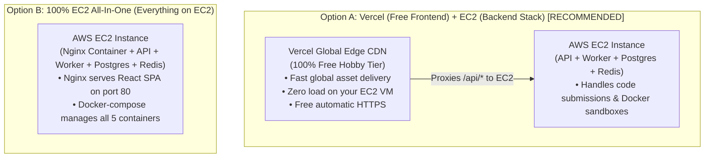
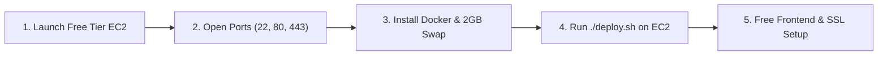

# Verdict Engine — Strictly Zero-Extra-Cost Deployment Plan
### (AWS EC2 Only + 100% Free Ecosystem Services)

This guide provides an end-to-end deployment plan designed specifically to **incur $0 in cloud costs beyond your baseline EC2 instance**. 

You will **NOT** use any paid AWS managed services (no AWS RDS, no ElastiCache, no AWS Load Balancers, no Route 53). All auxiliary services leverage battle-tested, 100% free-forever tiers.

---

## 1. Zero-Cost Financial Blueprint

| Architecture Component | Traditional Expensive AWS Setup | **Verdict Engine Zero-Cost Setup** | Monthly Savings |
| :--- | :--- | :--- | :--- |
| **Compute / Worker** | AWS EC2 (`t3.small` / `t2.micro`) | **AWS EC2 (Only AWS Service Used)**<br/>*(Free Tier: 750 hrs/mo free for 12 mos)* | Baseline |
| **Database** | AWS RDS PostgreSQL (~$25 - $40/mo) | **Docker PostgreSQL on EC2 (`verdict_postgres`)** | **Save ~$30/mo** |
| **Message Queue** | AWS ElastiCache Redis (~$20 - $35/mo) | **Docker Redis on EC2 (`verdict_redis`)** | **Save ~$25/mo** |
| **Load Balancer** | AWS Application Load Balancer (~$22/mo) | **Reverse Proxy via Nginx / Caddy or Vercel** | **Save ~$22/mo** |
| **Frontend CDN** | AWS CloudFront + S3 | **Vercel Hobby Tier (100% Free Forever)** | **Save ~$5/mo** |
| **DNS / Domain** | AWS Route 53 ($0.50/mo + queries) | **DuckDNS (100% Free)** or Cloudflare Free | **Save ~$1/mo** |
| **SSL / TLS** | AWS ACM / Private CA | **Let's Encrypt / Vercel Auto-SSL (100% Free)**| **Save ~$10/mo** |
| **Total Cloud Add-ons** | **~$70 - $110 / month** | **$0.00 / month** | **100% Free** |

---

## 2. System Architecture Options

You have two zero-cost architecture options. Both avoid all paid AWS services:



* **Option A (Recommended)**: Vercel hosts the React frontend for free, offloading all static asset traffic, SSL termination, and client visits from your EC2 instance. Your EC2 instance reserves 100% of its CPU and RAM for code execution sandboxes.
* **Option B (All-In-One)**: The EC2 instance hosts both the frontend (via the included Nginx container) and backend. It requires no Vercel account, keeping everything inside a single Docker Compose stack on EC2.

---

## 3. Step-by-Step Deployment Roadmap



---

### Step 1: Launch EC2 Instance (AWS Free Tier Eligible)

1. Log in to [AWS Console](https://console.aws.amazon.com/ec2) and navigate to **EC2 > Launch an instance**.
2. **Name**: `verdict-engine`
3. **OS Image (AMI)**: **Ubuntu Server 24.04 LTS (HVM)** (Free Tier eligible).
4. **Instance Type**:
   * **`t2.micro`**: Free Tier eligible (750 free hours/month for 12 months).
   * *Or `t3.small` / `t4g.small` ($10-$14/mo) if you need higher compilation concurrency.*
5. **Key Pair**: Create or select a key pair (`.pem` file), e.g., `verdict-key.pem`.
6. **Storage**: Set root volume to **30 GiB gp3** (AWS Free Tier includes up to 30 GiB of free EBS storage!).
7. Click **Launch Instance**.

---

### Step 2: Configure Free Security Group (No Paid Firewalls)

Configure the instance's Security Group with standard free inbound rules:

| Type | Port Range | Protocol | Source | Purpose |
| :--- | :--- | :--- | :--- | :--- |
| **SSH** | `22` | TCP | `0.0.0.0/0` (or Your IP) | Terminal administration |
| **HTTP** | `80` | TCP | `0.0.0.0/0` | Public Web & API ingress |
| **HTTPS** | `443` | TCP | `0.0.0.0/0` | Free SSL ingress |

> [!CAUTION]
> Do **NOT** open port `5432` (PostgreSQL) or `6379` (Redis). Both run securely inside the internal Docker network (`verdict_net`) at zero extra cost.

---

### Step 3: Server Setup & Free 2GB Swap Memory

Connect to your EC2 instance:
```bash
ssh -i /path/to/verdict-key.pem ubuntu@<YOUR_EC2_PUBLIC_IP>
```

Run this automated script to install **Docker**, **Docker Compose**, **Git**, and create a **2 GB Swap file** (vital for preventing out-of-memory errors on `t2.micro` instances):

```bash
# 1. Update package index and install tools
sudo apt-get update && sudo apt-get install -y ca-certificates curl gnupg git

# 2. Add Docker's official GPG key
sudo install -m 0755 -d /etc/apt/keyrings
curl -fsSL https://download.docker.com/linux/ubuntu/gpg | sudo gpg --dearmor -o /etc/apt/keyrings/docker.gpg
sudo chmod a+r /etc/apt/keyrings/docker.gpg

# 3. Add Docker repository
echo "deb [arch=$(dpkg --print-architecture) signed-by=/etc/apt/keyrings/docker.gpg] https://download.docker.com/linux/ubuntu $(. /etc/os-release && echo "$VERSION_CODENAME") stable" | sudo tee /etc/apt/sources.list.d/docker.list > /dev/null

# 4. Install Docker Engine and Compose plugin (Free open-source)
sudo apt-get update
sudo apt-get install -y docker-ce docker-ce-cli containerd.io docker-buildx-plugin docker-compose-plugin

# 5. Add 'ubuntu' user to docker group
sudo usermod -aG docker ubuntu

# 6. Create 2GB swap file (FREE virtual RAM using EBS storage)
sudo fallocate -l 2G /swapfile
sudo chmod 600 /swapfile
sudo mkswap /swapfile
sudo swapon /swapfile
echo '/swapfile none swap sw 0 0' | sudo tee -a /etc/fstab

# 7. Apply permissions
newgrp docker
```

---

### Step 4: Clone Codebase & Launch Self-Hosted Backend

1. **Clone repository onto EC2**:
   ```bash
   cd ~
   git clone https://github.com/<YOUR_GITHUB_USERNAME>/<YOUR_REPO>.git verdict-engine
   cd verdict-engine
   ```

2. **Configure production environment file (`.env.prod`)**:
   ```bash
   cp .env.prod.example .env.prod
   nano .env.prod
   ```

   Fill in your configuration:
   ```env
   POSTGRES_USER=postgres
   POSTGRES_PASSWORD=your_strong_postgres_password_here
   POSTGRES_DB=online_judge

   # Generate a 64-character key: openssl rand -base64 32
   JWT_SECRET=your_super_secret_jwt_key_here

   APP_PORT=80
   ```

3. **Deploy the stack via `deploy.sh`**:
   ```bash
   chmod +x deploy.sh
   ./deploy.sh
   ```

   The script automatically:
   * Pre-pulls `gcc:latest` compiler image (sub-second cold start for submissions).
   * Launches PostgreSQL and Redis containers (saving you $50+/month on AWS RDS/ElastiCache).
   * Launches the Express API and sandboxed BullMQ worker.
   * Synchronizes the Prisma schema (`prisma db push`) to ensure database tables are created.
   * *(Note: Seeding is deliberately excluded from `deploy.sh` to protect production databases. To seed manually on dev/staging, run `npm run seed` from root or `npx tsx prisma/seed.ts` inside the api folder).*
   * Performs an instant health check.

---

### Step 5: Connecting the Free Frontend & Free SSL

#### Path A: Vercel Free Frontend (Recommended)
* **Cost**: $0.00 forever.
* **Benefits**: Ultra-fast global CDN, automatic SSL certificates, zero EC2 CPU usage for frontend visits.

1. Push your repository to GitHub.
2. Sign in to [Vercel](https://vercel.com) (free Hobby account).
3. Import your repository:
   * **Root Directory**: `client`
   * **Framework Preset**: `Vite`
   * **Build Command**: `npm run build`
   * **Output Directory**: `dist`
4. In [`client/vercel.json`](file:///d:/Projects/Online_Judge/client/vercel.json), ensure the reverse proxy routes to your EC2 IP:
   ```json
   {
     "rewrites": [
       {
         "source": "/api/:match*",
         "destination": "http://<YOUR_EC2_PUBLIC_IP>/api/:match*"
       },
       {
         "source": "/health",
         "destination": "http://<YOUR_EC2_PUBLIC_IP>/health"
       },
       {
         "source": "/(.*)",
         "destination": "/index.html"
       }
     ]
   }
   ```
5. Click **Deploy**. Vercel gives you an immediate free HTTPS domain: `https://your-judge.vercel.app`.
   *(Because Vercel proxies `/api/*` server-to-server, there are zero CORS or mixed-content issues!)*

---

#### Path B: 100% on EC2 (All-in-One) + Free DuckDNS & Free SSL
* **Cost**: $0.00 forever.
* If you prefer not to use Vercel, the included Nginx container is already serving the frontend on port 80.

To add a free domain and free SSL:
1. Register a free subdomain at [DuckDNS.org](https://www.duckdns.org) (e.g. `verdict-engine.duckdns.org`) pointing to `<YOUR_EC2_PUBLIC_IP>`.
2. Install Caddy on EC2 (automatically gets free Let's Encrypt SSL certificates):
   ```bash
   sudo apt install -y debian-keyring debian-archive-keyring apt-transport-https curl
   curl -1sLf 'https://dl.cloudsmith.io/public/caddy/stable/gpg.key' | sudo gpg --dearmor -o /usr/share/keyrings/caddy-stable-archive-keyring.gpg
   curl -1sLf 'https://dl.cloudsmith.io/public/caddy/stable/debian.deb.txt' | sudo tee /etc/apt/sources.list.d/caddy-stable.list
   sudo apt update && sudo apt install -y caddy
   ```
3. Set `APP_PORT=8080` in `.env.prod` and run `docker compose -f docker-compose.prod.yml up -d`.
4. Edit `/etc/caddy/Caddyfile`:
   ```caddy
   verdict-engine.duckdns.org {
       reverse_proxy localhost:8080
   }
   ```
5. Restart Caddy: `sudo systemctl restart caddy`.
   Your app is now live at `https://verdict-engine.duckdns.org` with 100% free SSL!

---

## 4. Free Maintenance & Backup Runbook

```bash
# 1. Update the app when you push new code (free, zero downtime)
cd ~/verdict-engine
./deploy.sh

# 2. View worker execution logs in real-time
docker compose -f docker-compose.prod.yml logs -f worker

# 3. Create a free local database backup
docker exec verdict_postgres pg_dump -U postgres online_judge > db_backup_$(date +%F).sql

# 4. Check system memory and swap usage
free -h
```

---

## 5. Verification Checklist

- [ ] EC2 instance created with 30GB gp3 storage (Free Tier eligible).
- [ ] Ports 22, 80, and 443 open in Security Group (No paid AWS load balancers).
- [ ] 2GB swap file enabled on EC2.
- [ ] PostgreSQL and Redis running inside Docker (saving ~$50/mo on AWS RDS/ElastiCache).
- [ ] Submissions successfully compile and run inside ephemeral `gcc:latest` sandboxes.
- [ ] Frontend connected via Vercel (Free Hobby Tier) or DuckDNS + Caddy (100% Free).
